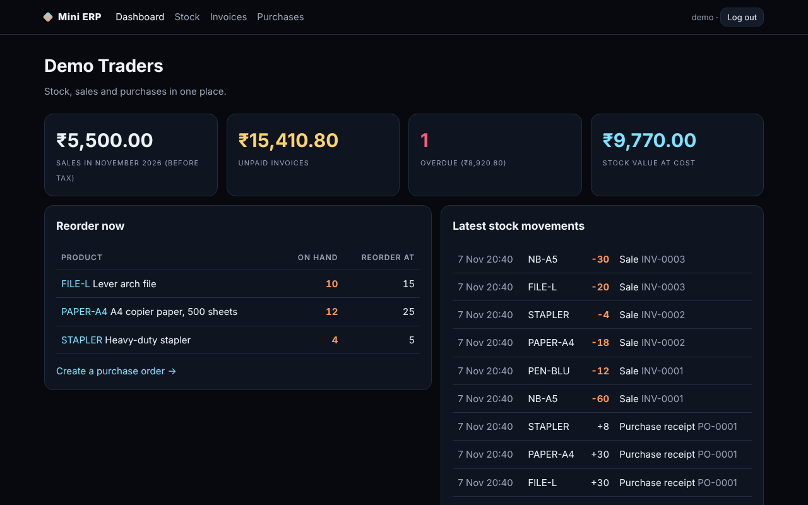
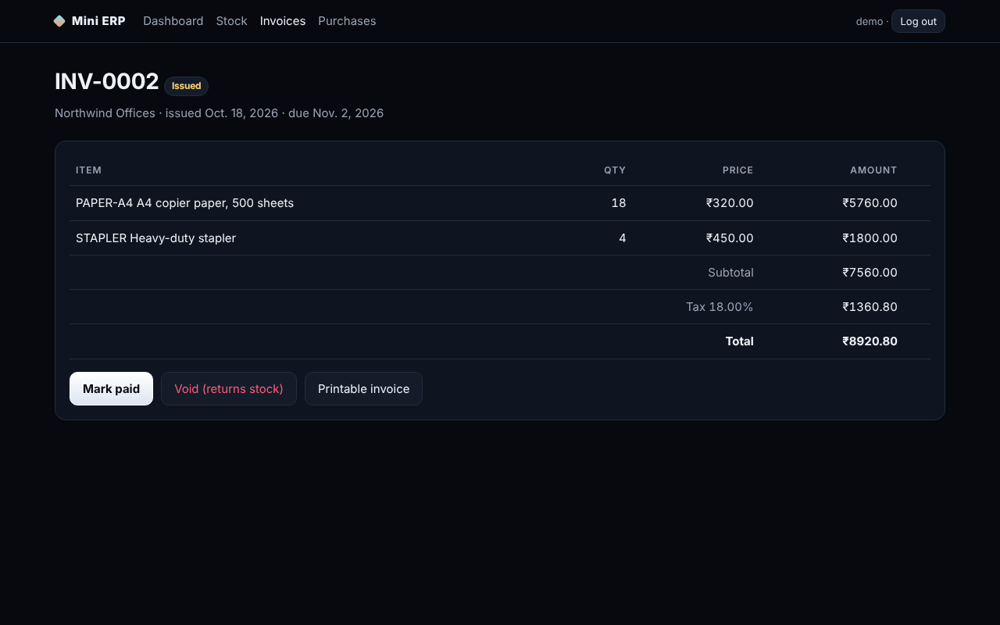

# Mini ERP

A small ERP for a trading business: **stock, purchase orders and invoices** in one Django app. Stock is never typed in; it is calculated from an append-only movement ledger, so every unit can be traced to a purchase, sale, return or adjustment.

Django 5, SQLite by default. Portfolio project with a fictional demo company.

<p align="center"></p>

## Features

| Area | What it does |
|---|---|
| Stock | Live on-hand from the ledger, reorder alerts, adjustments that need a reason and cannot go below zero |
| Purchases | Draft → ordered → received. Receiving adds stock exactly once |
| Invoices | Draft → issued → paid, or void. Issuing checks stock for all lines together, takes stock, assigns a gap-free number (INV-0001) and a due date |
| Money | Prices are snapshotted on each line; tax (default 18%) and totals use exact decimals with half-up rounding |
| Reports | Dashboard: sales this month, unpaid and overdue invoices, stock value at cost, latest movements |
| Print | Clean printable tax invoice page |

<p align="center"></p>

## Business rules enforced in code

- An invoice cannot be issued if any product would go below zero; nothing changes when it fails.
- Issued invoices cannot be edited. Voiding returns stock once; paid invoices cannot be voided (they need a credit note).
- A purchase order cannot be received twice.
- The stock ledger is read-only in the admin.
- Every change runs in one database transaction.

## Run it

```bash
pip install -r requirements.txt
python manage.py migrate
python manage.py seed_demo        # demo / demo12345, fictional company "Demo Traders"
python manage.py runserver
```

Settings: `ERP_COMPANY`, `ERP_TAX_RATE`, `ERP_CURRENCY`, `ERP_PAYMENT_DAYS` in `config/settings.py`.

## Tests

```bash
python manage.py test erp
```

16 tests cover the ledger, rounding, overselling, invoice numbering, void and paid rules, purchase receiving, price snapshots, staff-only pages and POST-only actions.

## Limitations

- One company, one currency, one tax rate; no credit notes, partial payments or multi-warehouse stock yet.
- Not certified for any country's e-invoicing rules.

## License

MIT. Portfolio project by [Komarapu Jordan Ephraim](https://komarapujordanephraim-creator.github.io).
